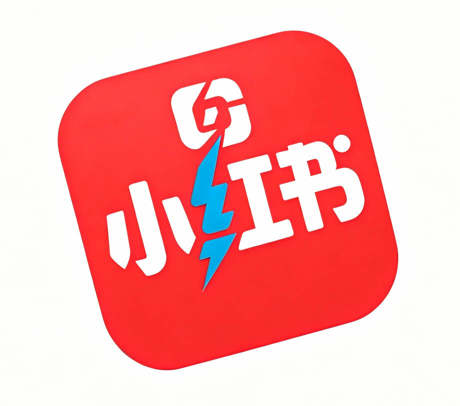
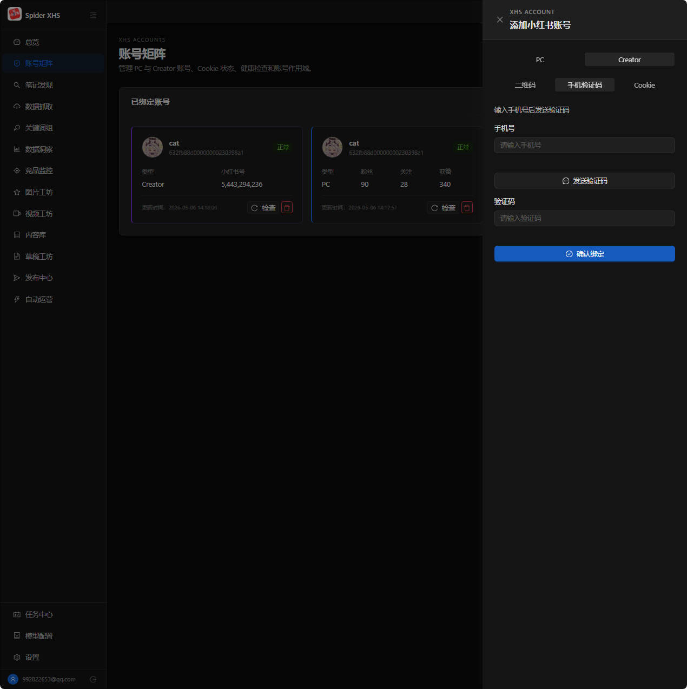
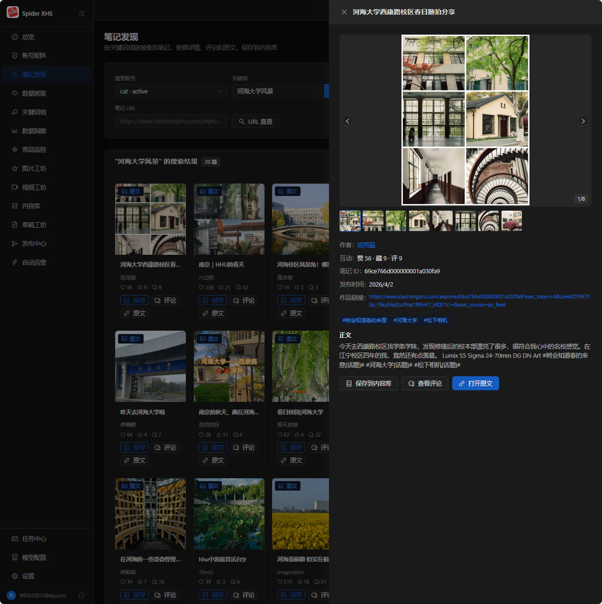
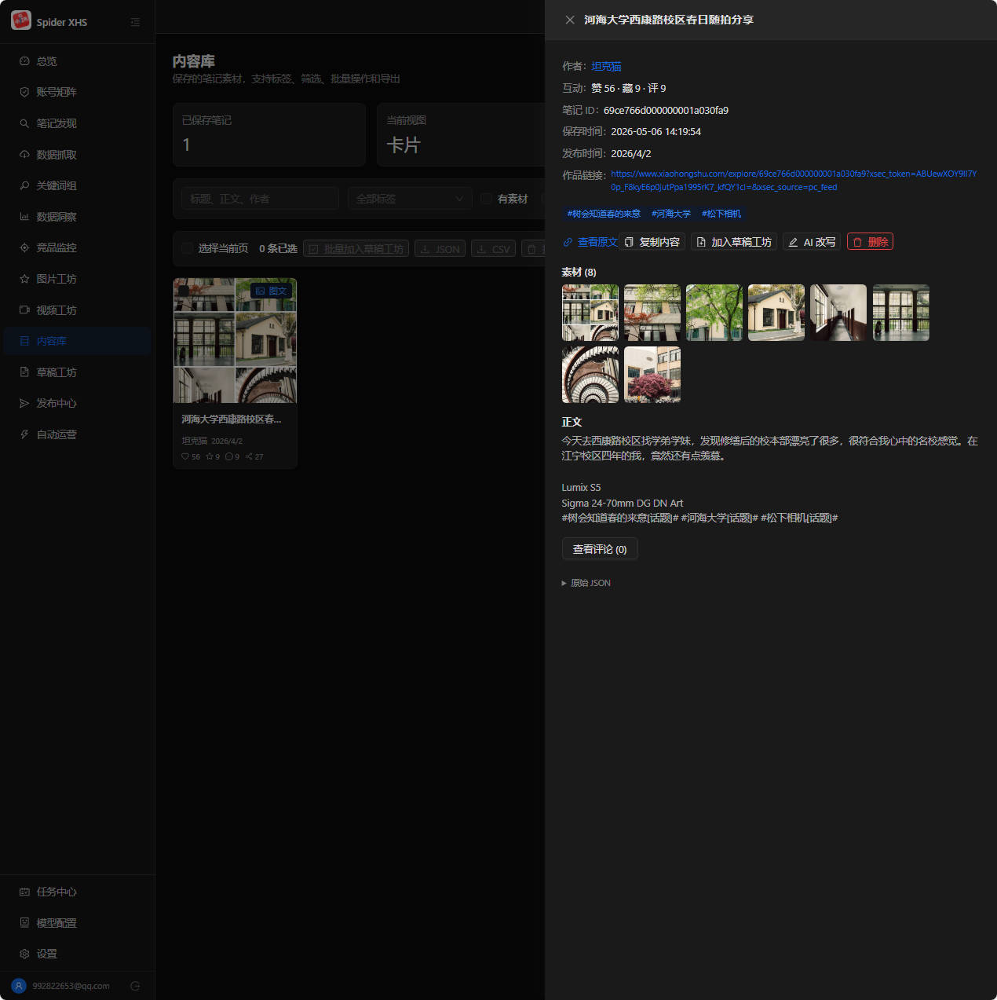
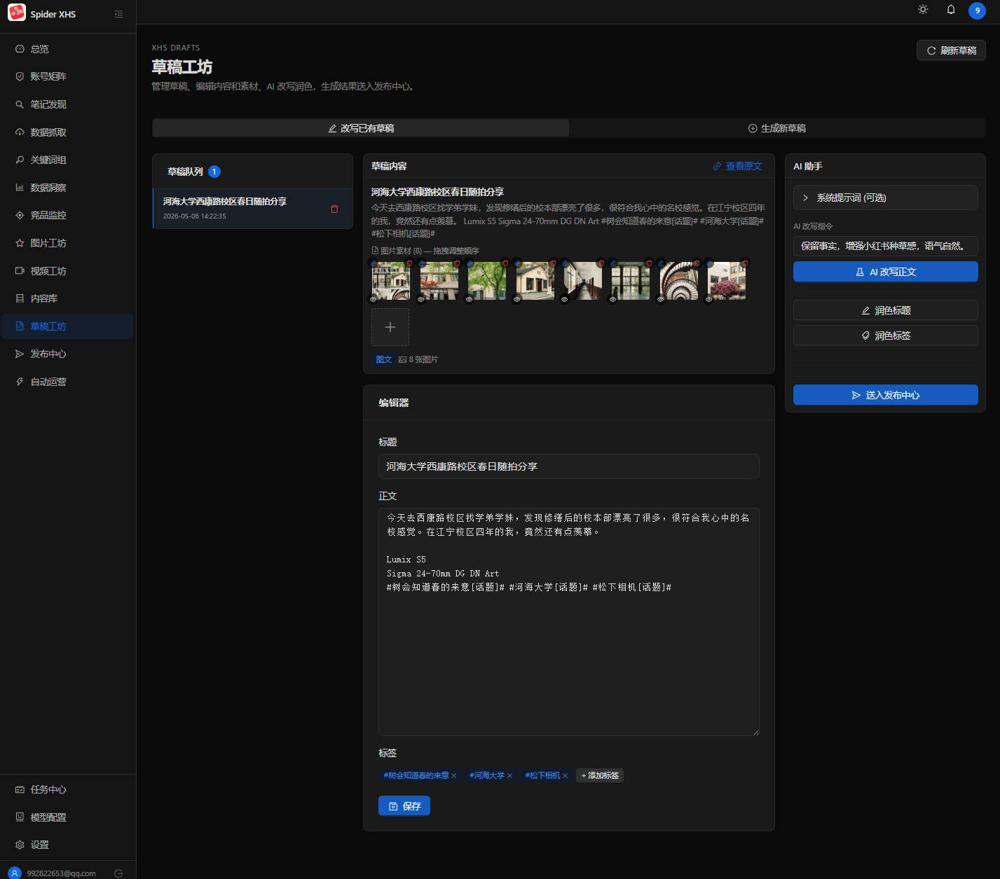
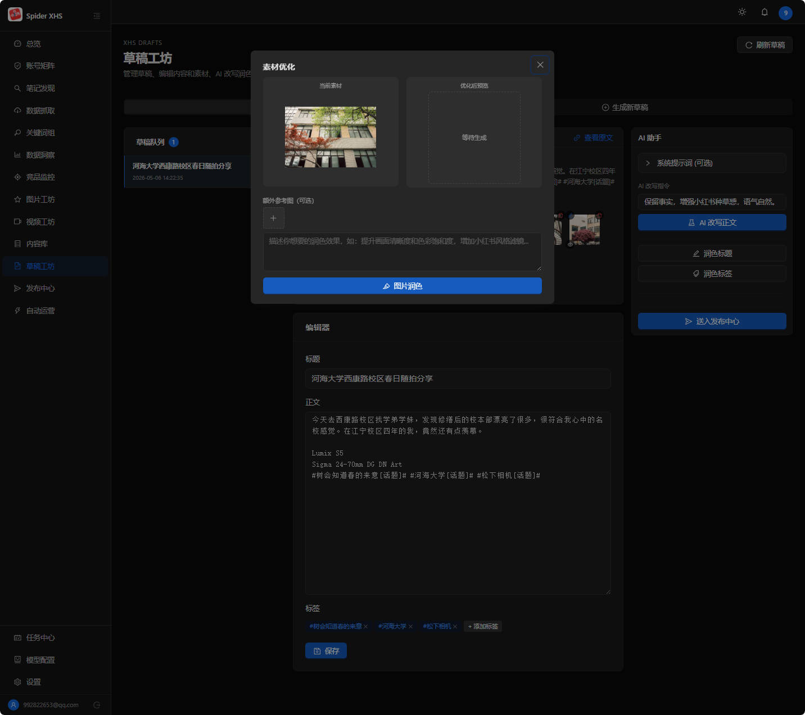
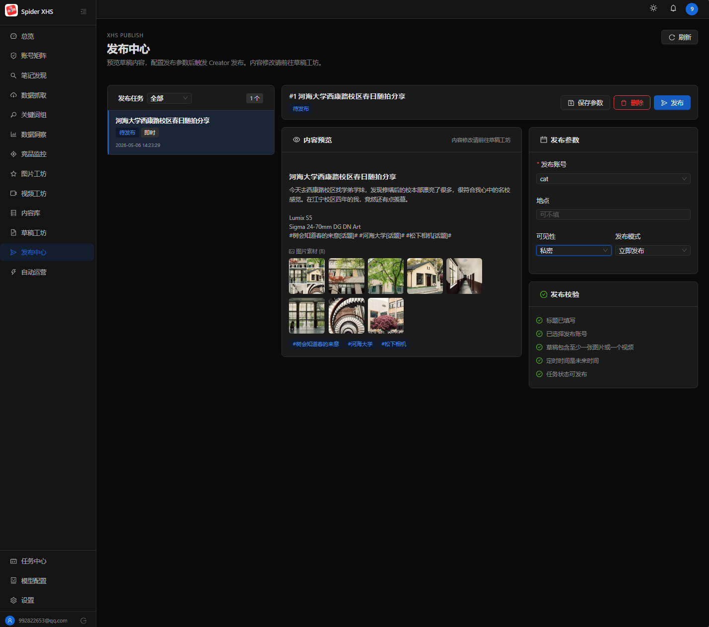
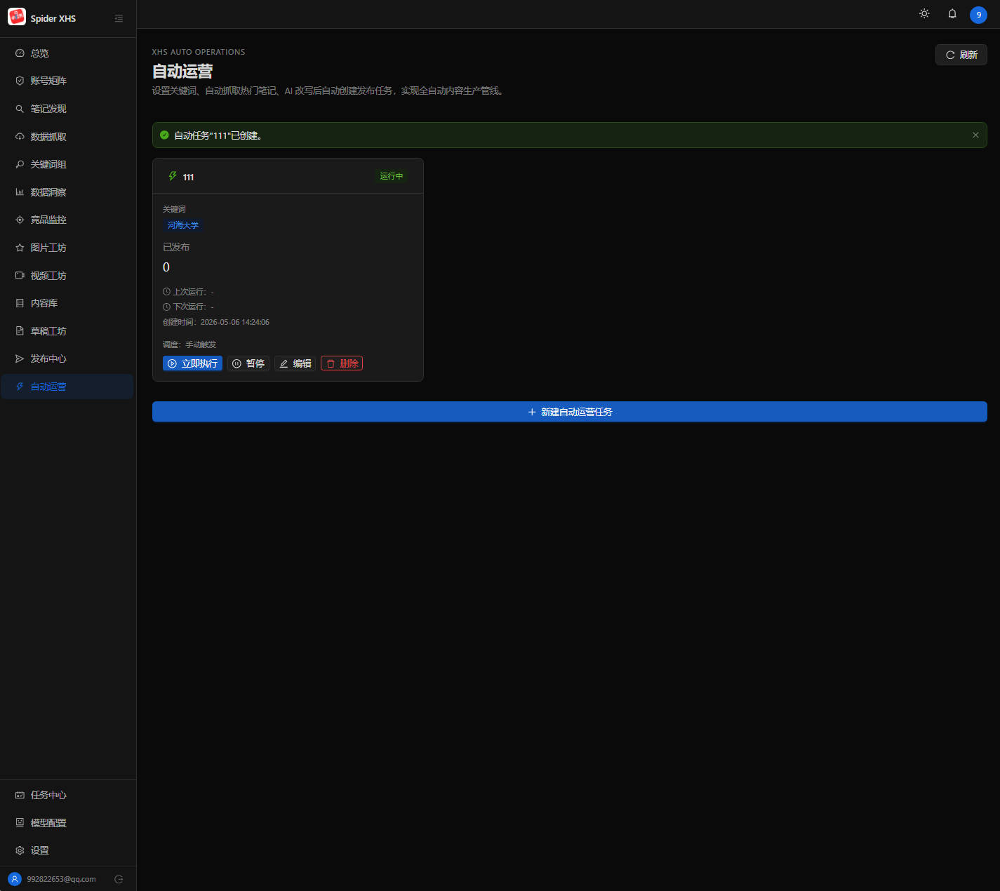

<p align="center">
  <a href="https://github.com/cv-cat/XHS_ALL_IN_ONE" target="_blank">
    <picture>
      
    </picture>
  </a>
</p>

<div align="center">

# XHS_ALL_IN_ONE

**小红书一站式智能运营平台 — 采集、分析、AI 创作、自动发布，全链路闭环**

[](https://github.com/cv-cat/XhsSkills)
[](https://www.python.org/)
[](https://nodejs.org/)
[](https://fastapi.tiangolo.com/)
[](https://react.dev/)
[](https://www.docker.com/)
[](LICENSE)

</div>

> 市面上的小红书工具要么只能爬数据，要么只能发笔记，要么需要手动复制粘贴到 AI 平台再贴回来。
> **XHS_ALL_IN_ONE 是第一个把「采集 → 内容库 → AI 改写 → 图片润色 → 一键发布 → 定时自动运营」全链路打通的开源平台。**
> 一个浏览器标签页，完成别人用 5 个工具才能做的事。

**⚠️ 本项目仅供学习交流使用，禁止任何商业化行为，如有违反，后果自负**

---

## 核心优势

| | 传统方案 | XHS_ALL_IN_ONE |
|---|---|---|
| **数据采集** | 写脚本 / 用第三方爬虫 | 平台内搜索 + 一键入库，素材自动下载到本地 |
| **内容管理** | Excel / 文件夹 / 各种笔记软件 | 统一内容库，标签筛选，卡片预览 |
| **AI 改写** | 复制到 ChatGPT → 手动粘贴回来 | 编辑器内一键改写，标题/正文/标签全覆盖 |
| **图片处理** | Photoshop / 在线工具 | AI 图片润色 + 参考图，原位替换 |
| **发布** | 手动打开创作者平台上传 | 选账号 → 点发布，支持定时 |
| **自动化** | 没有 / 需要写代码 | 配置关键词 + 频率，全自动：搜索→改写→发布 |
| **多账号** | 反复切换浏览器 | 账号矩阵统一管理，2h 自动健康巡检 |

---

## 平台预览

### 账号矩阵 — 多账号绑定与健康管理

支持绑定多个 PC / Creator 账号，扫码登录、手机验证码、Cookie 导入三种方式。Cookie 加密存储，2 小时自动健康巡检，过期自动通知。



### 笔记发现 — 关键词搜索与详情预览

输入关键词一键搜索小红书全站笔记，支持排序、类型、时间等多维筛选。点击笔记卡片打开详情抽屉，查看无水印原图、互动数据、评论区，一键保存到内容库。



### 内容库 — 采集内容的统一管理

所有采集到的笔记统一沉淀在内容库，属于平台用户而非某个 XHS 账号。卡片/列表双视图，支持自定义标签、关键词搜索、批量操作、JSON/CSV 导出。



### 草稿工坊 — AI 改写与内容编辑

三栏布局：草稿队列 + 编辑器 + AI 助手。从内容库深拷贝笔记进入草稿，AI 一键改写正文、润色标题、生成标签，拖拽排序图片素材，编辑完成直接送入发布中心。



### 素材优化 — AI 图片润色

选择草稿中的任意图片，添加参考图，输入润色指令，AI 生成优化后的图片并原位替换。当前素材和优化结果并排对比，点击即可放大预览。



### 发布中心 — 一键发布到小红书

预览草稿内容和图片素材，选择 Creator 账号，设置可见性和发布模式（立即/定时），发布校验通过后一键发布到小红书创作者平台。



### 自动运营 — 全自动内容生产管线

设置关键词和调度频率（每日/每周/自定义间隔），系统自动执行完整管线：搜索热门笔记 → AI 改写标题+正文 → 上传图片素材 → 通过 Creator API 自动发布。真正的无人值守。



---

## ⭐ 完整功能清单

### 底层 SDK（逆向签名算法，透明封装）

| 模块 | 功能 | 状态 |
|------|------|------|
| **小红书 PC 端** | 二维码登录 / 手机验证码登录 | ✅ |
| | 搜索笔记 & 搜索用户 | ✅ |
| | 获取笔记详情（无水印图片 & 视频） | ✅ |
| | 获取笔记评论 | ✅ |
| | 获取用户发布 / 喜欢 / 收藏的笔记 | ✅ |
| | 获取用户主页信息 / 自己的账号信息 | ✅ |
| | 获取主页推荐 / 未读消息 | ✅ |
| **创作者平台** | 二维码登录 / 手机验证码登录 | ✅ |
| | 上传图集 / 视频作品 | ✅ |
| | 查看已发布作品列表 | ✅ |
| **蒲公英平台** | KOL 博主列表 & 粉丝画像 & 合作邀请 | ✅ |
| **千帆平台** | 分销商列表 & 合作品类 / 商品信息 | ✅ |

### Web 运营平台

| 模块 | 功能 |
|------|------|
| **账号矩阵** | 多 PC / Creator 账号绑定、Cookie 加密存储、2h 自动健康巡检、过期通知 |
| **笔记发现** | 关键词搜索、URL 直查、多维筛选、已保存标记、一键入库 |
| **数据抓取** | 批量 URL / 搜索 / 评论抓取、Excel 导出、素材本地下载 |
| **内容库** | 卡片/列表双视图、自定义标签、批量操作、JSON/CSV 导出、查看原文 |
| **草稿工坊** | 三栏编辑器、AI 改写正文、润色标题/标签、拖拽排序素材、AI 图片润色 |
| **图片工坊** | AI 图片生成（支持参考图）、图片描述、AI/普通图片资产管理 |
| **发布中心** | 图集发布、定时发布、发布校验、状态追踪、重试/取消 |
| **自动运营** | 定时任务（每日/每周/自定义间隔）、全自动管线：搜索→AI改写→上传→发布 |
| **数据洞察** | 仪表盘总览、互动趋势、Top 内容、热门话题、评论分析 |
| **竞品监控** | 关键词/账号/品牌/URL 监控、自动爬取刷新、快照历史 |
| **任务中心** | 全量任务审计、调度器状态、耗时追踪 |
| **通知系统** | Cookie 过期 / 任务失败自动通知、铃铛实时展示 |
| **模型配置** | 支持任意 OpenAI 兼容 API（火山引擎、阿里云百炼、OpenAI 中转等） |

### 平台扩展（规划中）

| 平台 | 状态 |
|------|------|
| 小红书 (XHS) | ✅ 已实现 |
| 抖音 (Douyin) | ✅ 已实现（首期：账号绑定、参考采集、真实指标、审核后发布；上游能力见 `vendor/PROVENANCE.md`） |
| 快手 (Kuaishou) | Coming Soon |
| 微博 (Weibo) | Coming Soon |
| 闲鱼 (Xianyu) | Coming Soon |
| 淘宝 (Taobao) | Coming Soon |

---

## 🧩 Skills 支持

当前项目已支持基于 skills 的能力接入，可直接作为底层能力仓库使用，也可通过标准化 skills 方式被上层 Agent 工具链引入。

封装好的 skills 请查看 [XhsSkills](https://github.com/cv-cat/XhsSkills)，可被 `Clawbot`、`Claude Code`、`Codex` 等工具直接引入与集成。

---

## 🛠️ 快速开始

### 环境要求

- Python 3.10+
- Node.js 20+

### 安装依赖

```bash
git clone https://github.com/cv-cat/XHS_ALL_IN_ONE.git
cd XHS_ALL_IN_ONE

pip install -r requirements.txt
npm install
cd frontend && npm install && cd ..
```

### 启动项目

```bash
# 一键启动（后端 + 前端）
python main.py --with-frontend
```

启动后访问：
- 前端: http://localhost:5173
- API 文档: http://localhost:8000/docs

首次启动自动创建数据库，注册账号即可使用。

### Docker 部署

```bash
# 1. 准备环境变量（SECRET_KEY 必填，否则生产环境会拒绝启动）
cp .env.example .env
python -c "import secrets; print(secrets.token_urlsafe(48))"   # 写入 .env 的 SECRET_KEY

# 2. 启动（默认只绑定 127.0.0.1:8000；需要公网访问时设置 APP_BIND_ADDR=0.0.0.0，
#    并在前面加反向代理做 TLS 终止）
docker compose up -d
```

默认使用 SQLite 单容器（开箱可用）；接 MySQL 时设置 `DATABASE_TYPE=mysql`
与 `DATABASE_MYSQL_*`，并放开 compose 中注释的 mysql 段。

### 测试

```bash
# 后端（pytest，含 tests/backend 与 tests/douyin）
pip install -r requirements-dev.txt
python -m pytest

# 前端
cd frontend
npm run typecheck     # TypeScript 严格检查
npm test              # vitest 单元测试
npm run test:node     # 路由/组件集成测试（node:test）

# 端到端冒烟（真实后端 + 前端；首次需安装浏览器）
npx playwright install chromium
npm run test:e2e
```

> CI（.github/workflows/ci.yml）包含 5 个门禁：密钥扫描、后端 pytest（并行）、
> 前端 typecheck/lint/单测、构建、Playwright e2e。

---

## 📁 项目结构

```
XHS_ALL_IN_ONE/
├── main.py                         # 统一启动入口
├── config/                         # YAML 配置（default / production）
├── apis/                           # XHS 底层 SDK（逆向签名 + HTTP 接口）
├── xhs_utils/                      # 签名算法封装
├── static/                         # 签名核心 JS 文件
├── backend/
│   └── app/
│       ├── main.py                 # FastAPI 应用
│       ├── core/                   # 配置、数据库、安全、时区
│       ├── models/                 # SQLAlchemy 数据模型（20+ 张表）
│       ├── api/                    # API 路由
│       ├── services/               # 业务逻辑 + 定时调度
│       ├── adapters/xhs/           # XHS SDK 适配层
│       └── storage/                # 媒体文件 + 导出文件
├── frontend/
│   └── src/
│       ├── pages/platforms/xhs/    # 各功能页面
│       ├── components/layout/      # 侧边栏 + 通知系统
│       ├── lib/api.ts              # HTTP 客户端
│       └── types/                  # TypeScript 类型
├── tests/                          # 后端测试（pytest）
├── Dockerfile                      # 多阶段构建
└── docker-compose.yml              # 编排文件
```

---

### 剪辑工坊（OpenCut）

独立应用 `/clip`，把内容库、草稿和本地上传素材送到独立编辑器，导出 MP4 后回到工作台，可送入小红书草稿或抖音发布中心。

- 编辑器地址：`CLIP_EDITOR_PUBLIC_BASE_URL`（默认 `http://127.0.0.1:3000`）
- 允许的编辑器来源：`CLIP_EDITOR_ALLOWED_ORIGINS`（只对 `/api/clip/*` 生效的 CORS）
- 成片大小上限：`CLIP_MAX_EXPORT_BYTES`（默认 2GiB）
- 会话有效期：`CLIP_SESSION_TTL_HOURS`（默认 12 小时）
- 活跃会话上限：`CLIP_MAX_ACTIVE_SESSIONS`（默认 3）
- 每用户成片配额：`CLIP_USER_EXPORT_QUOTA_BYTES`

M1/M2 验证阶段使用 `tools/clip-editor-stub` 契约编辑器：

```bash
docker compose up -d editor
python main.py --with-frontend
```

OpenCut fork 完成后，将 `docker-compose.yml` 中 `editor` 服务的构建上下文替换为 fork 镜像，工作台接口不变。

## 🛠 运维与可观测性

| 能力 | 说明 |
|---|---|
| **请求 ID** | 每个响应带 `X-Request-ID`（请求头传入则透传），日志行自动携带，便于串联同一次请求 |
| **结构化日志** | `LOG_JSON=1` 输出 JSON 行（含 request_id），`LOG_LEVEL` 控制级别 |
| **指标** | `GET /api/metrics` 输出 Prometheus 文本格式（请求数/延迟/并发度），零额外依赖 |
| **SQLite 备份** | 调度器每 24h 执行 `VACUUM INTO` 快照到 `data/backups/`，保留最近 `BACKUP_KEEP` 份 |
| **分布式限流** | 设置 `REDIS_URL` 后登录限流与抓取限速在多 worker 间共享；未设置则回退进程内存 |
| **长任务** | 手动运行自动运营超过 `TASK_SYNC_WAIT_SECONDS` 返回 202 + 任务 ID，到任务中心查看 |
| **全文检索** | 笔记写入时生成 `search_text`；SQLite 自动建 FTS5(trigram) 索引，短词自动回退 LIKE |
| **抖音隔离** | vendor 上游在子进程执行（崩溃隔离 + 硬超时），`DOUYIN_VENDOR_INPROCESS=1` 可回退排障 |

### 密钥轮换

```bash
# 密钥只从环境变量读取（不要写在命令行：会进入 shell history 与进程列表）
ROTATE_OLD_SECRET=<旧SECRET> ROTATE_NEW_FERNET_KEY=<新KEY>   python scripts/rotate_secrets.py --old-secret --new-fernet-key --dry-run
ROTATE_OLD_SECRET=<旧SECRET> ROTATE_NEW_FERNET_KEY=<新KEY>   python scripts/rotate_secrets.py --old-secret --new-fernet-key
```

## ⚙️ 配置说明

分层配置，优先级：`config/default.yaml` < `CONFIG_FILE` < `.env` < 环境变量

```yaml
database:
  type: "sqlite"                    # sqlite 或 mysql
security:
  secret_key: "change-me"          # JWT 签名密钥
scheduler:
  enabled: false                    # 启用定时任务（自动运营/监控/Cookie巡检）
```

主要环境变量：`SECRET_KEY`、`DATABASE_TYPE`、`DATABASE_URL`、`SCHEDULER_ENABLED`

---

## 🗝️ 注意事项

- `apis/` 是底层 SDK 层，**请勿直接修改**，上层通过 `backend/app/adapters/` 中转调用
- Cookie 有时效性，平台内置 2 小时自动健康巡检 + 过期通知
- 所有敏感数据（Cookie、API Key）使用 Fernet 加密存储
- AI 功能需在「模型配置」页面配置 OpenAI 兼容的 API 端点（支持火山引擎、阿里云百炼等）

---

## 🔐 安全升级与发布说明（2026-11）

本次安全修复（详见 `FIX_PLAN.md`）引入以下行为变化，升级前请阅读：

**必须操作**

1. **设置密钥**：生产/容器环境（`ENVIRONMENT=production`）未设置 `SECRET_KEY` 将**拒绝启动**。生成方式：
   ```bash
   python -c "import secrets; print(secrets.token_urlsafe(48))"
   ```
   通过环境变量 `SECRET_KEY` / `FERNET_KEY` 提供。
2. **密钥轮换**：从旧默认密钥迁移的存量库，先备份再运行 `python scripts/rotate_secrets.py --old-secret <旧KEY> --new-fernet-key <新KEY> --dry-run`，确认计数后去掉 `--dry-run` 实跑，最后切换环境变量。未轮换密文直接换密钥会导致 Cookie/API Key 永久不可解密。
3. **重新登录**：更换 `SECRET_KEY` 后所有已签发令牌失效，用户需重新登录。

**行为变化**

- refresh token 改为 HttpOnly Cookie（XSS 无法窃取），不再写入 localStorage；刷新/登出携带 `X-Requested-With` 头。
- 生产环境默认**关闭注册**（`REGISTRATION_ENABLED=true` 显式开启）；新密码最少 8 位；登录/注册有限流。
- 素材来源仅接受：本用户上传的媒体文件名、`/api/files/media/` 形式、白名单 CDN 域名 URL；批量入库默认只读（`save_to_library: true` 显式入库）。
- 列表接口全部服务端分页；上传超 100MB 返回 413；定时发布 `scheduled_at` 必须晚于当前时间。
- 健康检查改用 `/api/health/ready`（探测数据库与迁移版本）。

**已知限制（记录于 review）**

- `retry` 对 `immediate` 发布任务：任务回到 pending 后需在发布中心手动点击发布（调度器只消费 scheduled 任务）。
- 采集工具 UI 目前固定把抓取结果存入内容库；API 默认只读，如需纯预览请在 UI 层自行扩展开关。
- 登录/注册限流为单进程内存实现，多 worker 部署需外置 Redis。
- `scripts/rotate_secrets.py` 已被 `.dockerignore` 排除，请在宿主机对备份库执行。

**数据库与回滚**

- 升级前备份 `data/` 与 `backend/app/storage/`（含 `-wal`/`-shm`）；启动时自动执行 Alembic 迁移（新增 `auto_tasks.claimed_at`、`publish_jobs.user_id NOT NULL` 收紧、索引）。
- 回滚：代码回退到上一版本即可，新增列/索引可保留；删除账号时关联笔记会保留（账号引用置空）。

---

## 🧸 额外说明

1. 感谢 Star ⭐ 和 Follow，项目会持续更新
2. 作者联系方式在主页，有问题随时联系
3. 欢迎 PR 和 Issue，也欢迎关注作者其他项目

<div align="center">
  
  
</div>

---

## 📈 Star History


<a href="https://cvcat.site/star-history/svg?repos=cv-cat/XHS_ALL_IN_ONE&type=Date">
  <picture>
    <source media="(prefers-color-scheme: dark)" srcset="https://cvcat.site/star-history/svg?repos=cv-cat/XHS_ALL_IN_ONE&type=Date&theme=dark" />
    <source media="(prefers-color-scheme: light)" srcset="https://cvcat.site/star-history/svg?repos=cv-cat/XHS_ALL_IN_ONE&type=Date" />
    
  </picture>
</a>

---


## 🍔 交流群

如果你对爬虫和 AI Agent 感兴趣，可以加入群聊一起讨论~

ps: 请加群，人满或者过期 issue | wx 提醒 | qq提醒

| group-1 | group-2 | group-3 | group-4 (2000人qq群) |
|:--:|:--:|:--:|:--:|
|  |  |  |  |

---

## License

MIT License - see [LICENSE](LICENSE) for details.
